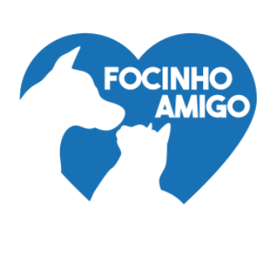
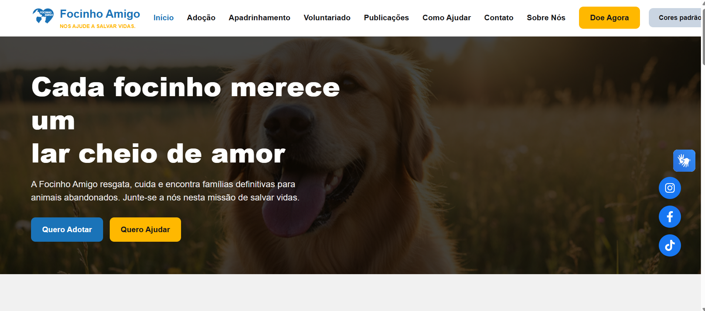
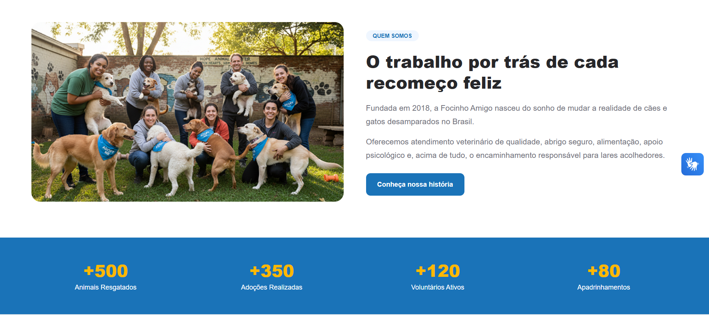
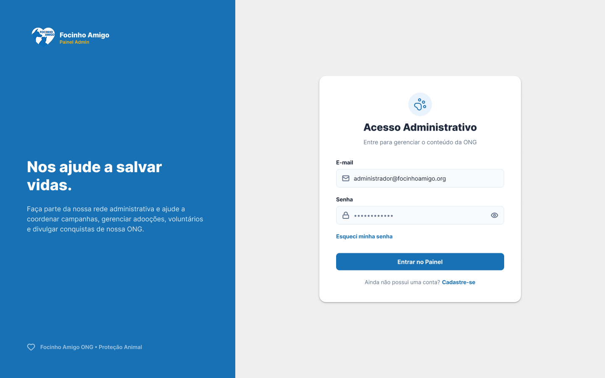
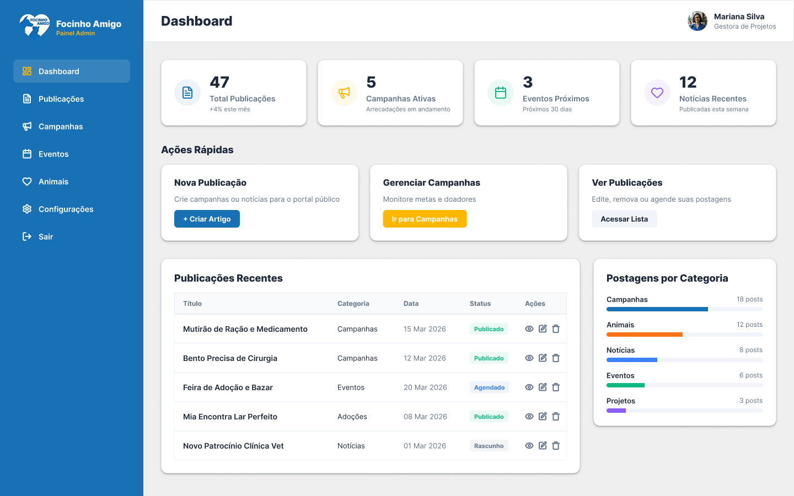
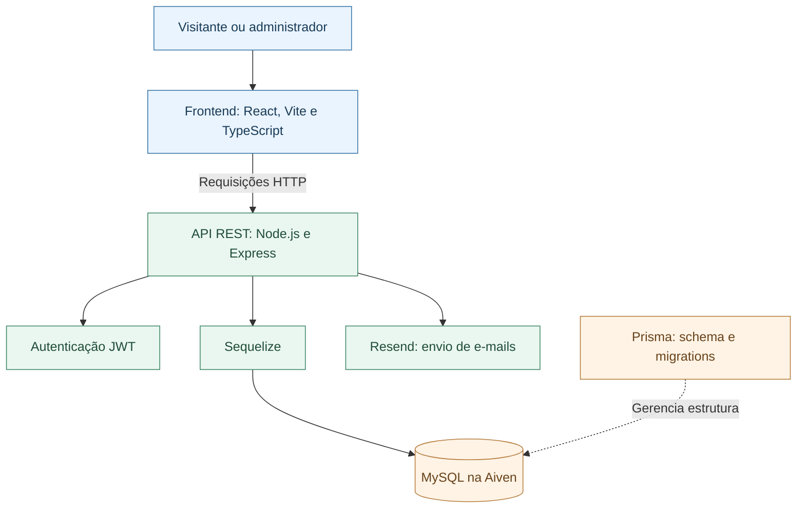

<div align="center">

<table><tr><td valign="middle"></td><td valign="middle"><h1>Focinho Amigo</h1><strong>Tecnologia a serviço da proteção animal</strong></td></tr></table>

**Plataforma web para apoiar a gestão de uma organização de proteção animal, ampliar sua presença digital e facilitar a adoção responsável.**

    

**3º lugar — Fatec Innovation Challenge 2026**  
Equipe **Hackeridos** · Fatec Sebrae

</div>

---

## Sumário

- [Visão geral](#visão-geral)
- [Contexto e solução](#contexto-e-solução)
- [Funcionalidades](#funcionalidades)
- [Impacto esperado](#impacto-esperado)
- [Reconhecimento](#reconhecimento)
- [Demonstração](#demonstração)
- [Tecnologias e arquitetura](#tecnologias-e-arquitetura)
- [Instalação e execução](#instalação-e-execução)
- [Banco de dados](#banco-de-dados)
- [Documentação da API](#documentação-da-api)
- [Qualidade e testes](#qualidade-e-testes)
- [Integrações e segurança](#integrações-e-segurança)
- [Desenvolvimento com IA](#desenvolvimento-com-ia)
- [Documentação técnica](#documentação-técnica)
- [Equipe](#equipe)

## Visão geral

O **Focinho Amigo** é uma plataforma web desenvolvida para a **OSCIP de Proteção Animal Focinho Amigo**, em resposta a um desafio do **Fatec Innovation Challenge 2026**.

Mais do que um site institucional, a solução reúne informações, oportunidades de participação e ferramentas administrativas em um único ambiente. O projeto foi concebido a partir das necessidades da organização, com foco na usabilidade, na comunicação com a comunidade e na simplificação de processos internos.

| Projeto | Informação |
| :--- | :--- |
| Organização atendida | OSCIP de Proteção Animal Focinho Amigo |
| Equipe | Hackeridos — Fatec Sebrae |
| Evento | Fatec Innovation Challenge 2026 |
| Reconhecimento | 3º lugar |
| Tipo de solução | Plataforma web com frontend, API e banco de dados |

## Contexto e solução

### O desafio

A organização precisa conciliar a divulgação de animais disponíveis para adoção, o atendimento a interessados, a comunicação com voluntários e apoiadores, a promoção de campanhas e a atualização de informações. A concentração de demandas no WhatsApp e a existência de tarefas manuais dificultam a organização do trabalho.

### Nossa proposta

Centralizar a presença digital e disponibilizar recursos de gestão para que a equipe possa dedicar mais tempo às atividades diretamente relacionadas à proteção animal.

| Necessidade | Resposta da plataforma |
| :--- | :--- |
| Informações dispersas | Conteúdo institucional e canais de participação reunidos em um único site |
| Divulgação de animais | Vitrine de animais disponíveis para adoção |
| Comunicação com apoiadores | Campanhas, eventos, voluntariado e newsletter |
| Atualização de conteúdo | Painel administrativo com acesso autenticado |

## Funcionalidades

| Módulo | Descrição |
| :--- | :--- |
| **Institucional** | Apresentação da ONG, sua história e atuação |
| **Adoção** | Divulgação dos animais disponíveis para adoção |
| **Apadrinhamento** | Orientações sobre apoio aos animais |
| **Voluntariado** | Divulgação de formas de participação |
| **Campanhas e eventos** | Publicação de iniciativas da organização |
| **Formas de ajudar** | Centralização das possibilidades de contribuição |
| **Newsletter** | Comunicação por e-mail com pessoas interessadas |
| **Administração** | Gerenciamento de animais e publicações |
| **Autenticação** | Controle de acesso à área administrativa |

## Impacto esperado

A plataforma foi planejada para melhorar o fluxo de comunicação, ampliar a visibilidade dos animais e reduzir tarefas repetitivas.

| Objetivo | Resultado esperado |
| :--- | :--- |
| **Reduzir a sobrecarga do WhatsApp** | Meta projetada de redução de até **70%**, por meio da disponibilização de informações e triagem inicial |
| **Ampliar as oportunidades de adoção** | Vitrine online acessível continuamente, favorecendo a descoberta dos animais |
| **Fortalecer a comunidade** | Canal próprio de newsletter para divulgar campanhas, eventos e arrecadações |
| **Reduzir retrabalho** | Meta projetada de eliminação de **100% da transcrição manual** de fichas por meio da sincronização de planilhas |

> **Importante:** os percentuais são **metas projetadas**, não resultados medidos. A confirmação depende de acompanhamento operacional e indicadores após a adoção do sistema pela ONG.

## Reconhecimento

<div align="center">
  
  <p><strong>3º lugar no Fatec Innovation Challenge 2026</strong></p>
</div>

A equipe Hackeridos conquistou o terceiro lugar no desafio de inovação promovido pela **Venturus** e pela **Fundação Iochpe**, em uma edição com equipes de outras 18 Fatecs e instituições parceiras.

O desenvolvimento envolveu levantamento de necessidades, definição de requisitos, planejamento da arquitetura, implementação e validação de uma solução orientada à realidade da organização.

---

### Destaque no portal da Fatec Sebrae

A conquista da equipe Hackeridos foi destaque no portal oficial da Fatec Sebrae.

[Leia a matéria completa](https://fatecsebrae.cps.sp.gov.br/equipe-hackeridos-conquista-o-3o-lugar-no-fatec-innovation-challenge-2026/)

## Demonstração

As imagens a seguir apresentam as principais interfaces desenvolvidas para a plataforma.

<table>
  <tr>
    <th align="center" width="50%">Página inicial</th>
    <th align="center" width="50%">Conteúdo institucional</th>
  </tr>
  <tr>
    <td align="center"></td>
    <td align="center"></td>
  </tr>
  <tr>
    <th align="center" width="50%">Painel administrativo</th>
    <th align="center" width="50%">Dashboard administrativo</th>
  </tr>
  <tr>
    <td align="center" ></td>
    <td align="center"></td>
  </tr>
</table>

### Protótipo no Figma

O protótipo de interface está disponível para consulta no **[Figma — Focinho Amigo | Website](https://www.figma.com/design/aGcBilq5WAKQM6nO0ikLXo/Focinho-Amigo---Website?node-id=0-1&p=f&t=9HuztDOlk8nqhORZ-0)**.


## Tecnologias e arquitetura

| Camada | Tecnologias |
| :--- | :--- |
| **Frontend** | React, Vite, TypeScript, React Router, React Icons |
| **Backend** | Node.js, Express, TypeScript, Sequelize, Prisma, JWT, Resend |
| **Persistência** | MySQL |
| **Testes** | Vitest, Supertest |
| **Hospedagem** | Vercel (frontend), Render (backend), Aiven (MySQL) |

### Visão da arquitetura



O **Sequelize** é utilizado pela aplicação para acesso ao banco de dados; o **Prisma** é empregado nas migrations e no gerenciamento da estrutura do banco.

## Instalação e execução

### Pré-requisitos

- Node.js **24.22.1** (versão definida em `.nvmrc`)
- npm **11** ou superior
- Git
- Instância MySQL acessível

### 1. Clonar o repositório

```bash
git clone https://github.com/nanda-marques/fic2026-fatec-sebrae-hackeridos.git
cd fic2026-fatec-sebrae-hackeridos
```

### 2. Instalar dependências

```bash
npm install
```

O repositório utiliza **npm workspaces** para gerenciar frontend e backend.

### 3. Configurar variáveis de ambiente

Crie os arquivos abaixo com base nos exemplos disponíveis:

| Arquivo de referência | Arquivo local |
| :--- | :--- |
| `backend/.env.example` | `backend/.env` |
| `frontend/.env.example` | `frontend/.env` |

No frontend, configure a URL da API local:

```env
VITE_API_URL=http://localhost:3000
```

No backend, preencha as variáveis de conexão MySQL, autenticação e integrações externas, seguindo **os nomes definidos em `backend/.env.example`**.

### 4. Iniciar os serviços

Em terminais separados, a partir da raiz:

**Terminal 1 — Backend**

```bash
npm run dev:backend
```

**Terminal 2 — Frontend**

```bash
npm run dev:frontend
```

### 5. Acessar localmente

| Serviço | Endereço |
| :--- | :--- |
| Frontend | `http://localhost:5173` |
| Backend | `http://localhost:3000` |
| Swagger | `http://localhost:3000/api-docs` |

## Banco de dados

O banco de dados é **MySQL**, com conexão configurada por variáveis de ambiente do backend. Os scripts do Prisma são executados a partir da raiz do repositório.

| Comando | Finalidade |
| :--- | :--- |
| `npm run db:generate` | Gerar o Prisma Client |
| `npm run db:migrate` | Criar e executar uma nova migration |
| `npm run db:deploy` | Aplicar migrations existentes |
| `npm run db:status` | Consultar o estado das migrations |
| `npm run db:studio` | Abrir a interface visual Prisma Studio |
| `npm run db:pull` | Atualizar o schema a partir do banco |

> Em um banco novo, verifique a inicialização dos registros obrigatórios, incluindo os cargos da área administrativa. Em produção, prefira o fluxo de aplicação de migrations existentes (`db:deploy`), conforme a configuração do projeto.

## Documentação da API

A API dispõe de documentação interativa com **Swagger**:

```text
http://localhost:3000/api-docs
```

Em produção, utilize `/api-docs` no domínio do backend publicado. A documentação permite consultar os endpoints disponíveis e seus contratos.

## Qualidade e testes

### Testes automatizados

```bash
npm test
```

A suíte do backend utiliza **Vitest** e **Supertest** e contempla serviços e rotas relacionados a autenticação, publicações, newsletter e recuperação de senha. Entre os fluxos mínimos de validação estão o login e a listagem de animais.

### Build de produção

```bash
npm run build
```

Builds individuais:

```bash
npm run build:frontend
npm run build:backend
```

### Análise estática do frontend

```bash
npm run lint:frontend
```

## Integrações e segurança

### Newsletter

O envio de e-mails utiliza **Resend**. As URLs associadas ao fluxo devem ser definidas por variáveis de ambiente, com valores apropriados para desenvolvimento e produção.

### Boas práticas de configuração

- Nunca versionar arquivos `.env` com credenciais reais.
- Utilizar `.env.example` somente como referência de configuração.
- Armazenar segredos de produção nas variáveis de ambiente dos provedores de hospedagem.
- Não publicar senhas, tokens, chaves ou credenciais administrativas no README.
- Compartilhar credenciais de avaliação apenas por canais privados e autorizados.

## Desenvolvimento com IA

A equipe utilizou **inteligência artificial como ferramenta de apoio ao desenvolvimento do frontend**, especialmente na elaboração de componentes, layouts e experiências de navegação.

O trabalho envolveu prompts estruturados, definição de requisitos, integração, revisão e validação das soluções geradas. As decisões de produto, a implementação final e a responsabilidade técnica permaneceram com a equipe.

## Documentação técnica

| Material | Localização |
| :--- | :--- |
| Documento de requisitos | [`docs/01_Requisitos/Documento_Requisitos_v2.pdf`](docs/01_Requisitos/Documento_Requisitos_v2.pdf) |
| Diagrama de arquitetura | [`docs/02_Arquitetura/Diagrama_Arquitetura_v2.md`](docs/02_Arquitetura/Diagrama_Arquitetura_v2.md) |
| Protótipo interativo (Figma) | [Focinho Amigo — Website](https://www.figma.com/design/aGcBilq5WAKQM6nO0ikLXo/Focinho-Amigo---Website?node-id=0-1&p=f&t=9HuztDOlk8nqhORZ-0) |
| Protótipos de interface (PDF) | [`docs/03_Prototipos/Prototipos_Interface_v2.pdf`](docs/03_Prototipos/Prototipos_Interface_v2.pdf) |
| Histórico de alterações | [`docs/04_Gerencia_de_Mudancas/Changelog.pdf`](docs/04_Gerencia_de_Mudancas/Changelog.pdf) |
| Documentos originais | [`docs/originais/`](docs/originais/) |

## Equipe

<div align="center">

**Hackeridos — Fatec Sebrae**


<h2 align="center">Conheça nossa equipe</h2>

<p align="center">
  Pessoas responsáveis pelo desenvolvimento do projeto.
</p>

<table align="center">
  <tr>
    <td align="center" width="160">
      <a href="https://github.com/nanda-marques">
        
      </a>
      <br>
      <strong>Fernanda</strong>
      <br><br>
      <a href="https://github.com/nanda-marques">
        
      </a>
      &nbsp;
      <a href="https://www.linkedin.com/in/nanda-marques/">
        
      </a>
    </td>
    <td align="center" width="160">
      <a href="https://github.com/MatheusBonfim265">
        
      </a>
      <br>
      <strong>Matheus</strong>
      <br><br>
      <a href="https://github.com/MatheusBonfim265">
        
      </a>
      &nbsp;
      <a href="https://www.linkedin.com/in/matheus-bonfim-22b7862b7/">
        
      </a>
    </td>
    <td align="center" width="160">
      <a href="https://github.com/Cosmic-Bubble">
        
      </a>
      <br>
      <strong>Mayra</strong>
      <br><br>
      <a href="https://github.com/Cosmic-Bubble">
        
      </a>
      &nbsp;
      <a href="https://www.linkedin.com/in/mayra-lima-passos/">
        
      </a>
    </td>
    <td align="center" width="160">
      <a href="https://github.com/Manuellasantos">
        
      </a>
      <br>
      <strong>Manuella</strong>
      <br><br>
      <a href="https://github.com/Manuellasantos">
        
      </a>
      &nbsp;
      <a href="https://www.linkedin.com/in/manu-cruz-8439332b6/">
        
      </a>
    </td>
  </tr>
</table>

</div>

O projeto foi construído coletivamente, reunindo planejamento, desenvolvimento, validação e entrega. Nosso propósito é aplicar tecnologia a problemas reais e contribuir para a atuação de organizações com impacto social.

---

<div align="center">

**Focinho Amigo** — tecnologia, educação e proteção animal.

<sub>Desenvolvido pela equipe Hackeridos · Fatec Sebrae · Fatec Innovation Challenge 2026</sub>

</div>
