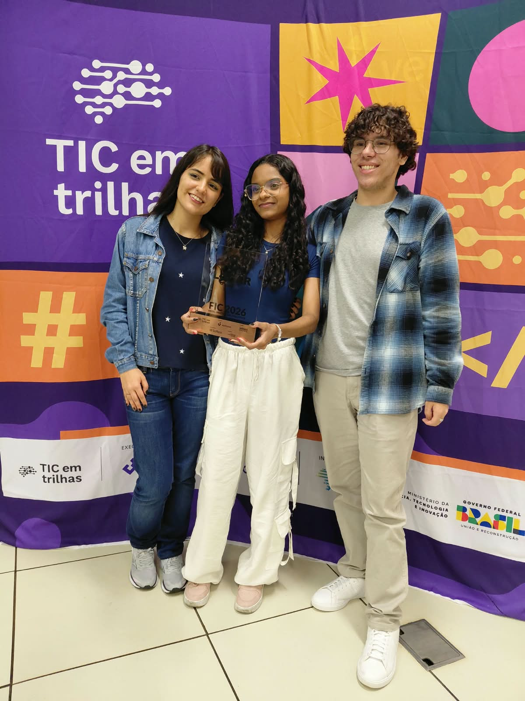
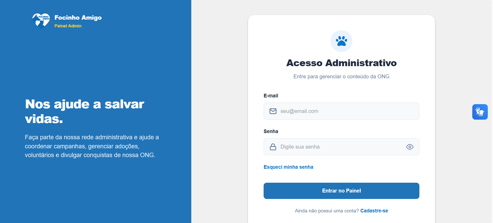

<h1 align="center">Focinho Amigo</h1> <p align="center">    </p> <p align="center">   <strong>Tecnologia a serviço da proteção animal.</strong>   <br>   Uma plataforma web para fortalecer a gestão da ONG, aproximar a comunidade e facilitar a adoção. </p> <p align="center">   <strong>3º LUGAR — FATEC INNOVATION CHALLENGE 2026</strong>   <br>   Entre equipes de 18 outras Fatecs participantes. </p>

---

## Índice

- Sobre o projeto
- Nossa conquista
- O problema e a nossa solução
- Funcionalidades
- Impacto esperado
- Desenvolvimento com inteligência artificial
- Conheça o sistema
- Tecnologias
- Estrutura do projeto
- Como executar
- Banco de dados
- Documentação da API (Swagger)
- Testes e build
- Newsletter
- Segurança
- Documentação técnica
- Equipe Hackeridos

---

## Sobre o projeto

O <b>Focinho Amigo</b> é uma plataforma web criada para a OSCIP de Proteção Animal Focinho Amigo, como resposta ao desafio do Fatec Innovation Challenge 2026.

Ele vai além de um site institucional: é uma ferramenta de apoio à gestão e à comunicação da ONG. Ela:

- centraliza as informações da organização;
- facilita a divulgação dos animais disponíveis para adoção;
- aproxima a ONG de pessoas que querem ajudar a causa animal.

O projeto nasceu de necessidades reais da organização e foi pensado para o uso no dia a dia. A ONG vai utilizar o sistema em sua rotina, o que dá à conquista um significado ainda maior.

---

## Nossa conquista

 <p align="center">    </p>

Ficamos em 3º lugar no Fatec Innovation Challenge 2026, iniciativa de inovação promovida pela Venturus e pela Fundação Iochpe. Competimos com equipes de outras 18 Fatecs e instituições parceiras.

Durante o desafio, nós:

1. entendemos as necessidades de uma organização do terceiro setor;
2. transformamos essas necessidades em requisitos;
3. planejamos a arquitetura tecnológica;
4. desenvolvemos uma aplicação voltada à realidade da ONG.

Mais do que uma colocação, conquistamos a chance de ver nosso projeto sair do ambiente acadêmico e ser usado na prática.

---

## O problema e a nossa solução

### O problema

A Focinho Amigo precisa conciliar muitas atividades para manter seu trabalho:

- divulgar animais disponíveis para adoção;
- se comunicar com interessados, voluntários e apoiadores;
- divulgar campanhas, eventos e arrecadações;
- organizar informações institucionais;
- atualizar conteúdos e registros;
- atender demandas que chegam por diferentes canais.

Hoje, a forte dependência do WhatsApp sobrecarrega a equipe e dificulta a organização das informações. Além disso, processos manuais de transcrição e atualização consomem um tempo que poderia ser dedicado ao cuidado dos animais.

### A solução

Uma plataforma que centraliza a presença digital da ONG e oferece ferramentas para facilitar a gestão. O objetivo é tornar a informação mais acessível para a comunidade e simplificar o trabalho de quem mantém a organização funcionando.

---

## Funcionalidades

 <table>   <tr>     <th align="left">Área</th>     <th align="left">O que faz</th>   </tr>   <tr>     <td><b>Página institucional</b></td>     <td>Apresenta a ONG, sua história e seu trabalho</td>   </tr>   <tr>     <td><b>Adoção</b></td>     <td>Divulga os animais disponíveis para encontrar um novo lar</td>   </tr>   <tr>     <td><b>Apadrinhamento</b></td>     <td>Explica como contribuir com os animais</td>   </tr>   <tr>     <td><b>Voluntariado</b></td>     <td>Divulga oportunidades de participação</td>   </tr>   <tr>     <td><b>Campanhas e eventos</b></td>     <td>Divulga iniciativas e ações da organização</td>   </tr>   <tr>     <td><b>Formas de ajudar</b></td>     <td>Reúne todas as possibilidades de contribuição</td>   </tr>   <tr>     <td><b>Newsletter</b></td>     <td>Aproxima quem quer acompanhar as atividades da ONG</td>   </tr>   <tr>     <td><b>Painel administrativo</b></td>     <td>Gerencia animais e publicações</td>   </tr>   <tr>     <td><b>Autenticação</b></td>     <td>Controla o acesso à área administrativa</td>   </tr> </table>

---

## Impacto esperado

O projeto foi pensado para gerar melhorias concretas na rotina da ONG. Estes são os quatro resultados que buscamos:

 <table>   <tr>     <td width="50%">       <b>Redução de até 70% na sobrecarga do WhatsApp</b>       <br><br>       O site faz a triagem inicial e tira dúvidas, liberando a equipe para casos urgentes e para as etapas finais da adoção.     </td>     <td width="50%">&nbsp;</td>   </tr>   <tr>     <td width="50%">&nbsp;</td>     <td width="50%">       <b>Maior taxa de adoção</b>       <br><br>       Com a vitrine online disponível 24 horas por dia, encurtamos o tempo de permanência dos animais na ONG.     </td>   </tr>   <tr>     <td width="50%">       <b>Base comunitária própria</b>       <br><br>       A captação ativa por e-mail cria um canal direto com apoiadores, sem depender das redes sociais para divulgar feiras e arrecadações.     </td>     <td width="50%">&nbsp;</td>   </tr>   <tr>     <td width="50%">&nbsp;</td>     <td width="50%">       <b>Eliminação de 100% do retrabalho</b>       <br><br>       A sincronização de planilhas elimina totalmente a transcrição manual de fichas.     </td>   </tr> </table>

> [!IMPORTANT] Os percentuais acima são metas e resultados projetados, não indicadores já comprovados. A validação depende do acompanhamento do uso do sistema no dia a dia da ONG.

---

## Desenvolvimento com inteligência artificial

Um dos diferenciais do projeto foi o uso de IA como apoio à construção do frontend.

- Como usamos: prompts estruturados e direcionados, em vez de comandos genéricos, para orientar a criação de componentes, layouts e experiências de navegação.
- Por quê: manter a consistência visual e atender aos requisitos reais da ONG.
- Papel da equipe: definir as necessidades, direcionar as soluções, integrar os componentes, validar e evoluir a aplicação.

A IA foi uma ferramenta de produtividade e apoio técnico. As decisões e a responsabilidade pelo resultado foram da equipe. A experiência mostrou como o uso consciente de novas ferramentas pode ampliar a capacidade de desenvolvimento e acelerar a construção de soluções digitais.

---

## Conheça o sistema

### Página inicial

 <p align="center">    </p>

### Página inicial (continuação)

 <p align="center">    </p>

### Painel administrativo

 <p align="center">    </p>

### Acesse o projeto

- Site institucional — Focinho Amigo
- Painel administrativo

A API (backend) é executada separadamente, em ambiente próprio.

---

## Tecnologias

 <table>   <tr>     <th align="left">Camada</th>     <th align="left">Tecnologias</th>   </tr>   <tr>     <td><b>Frontend</b></td>     <td>React, Vite, TypeScript, React Router, React Icons</td>   </tr>   <tr>     <td><b>Backend</b></td>     <td>Node.js, Express, TypeScript, Sequelize, Prisma, JWT, Resend</td>   </tr>   <tr>     <td><b>Banco de dados</b></td>     <td>MySQL</td>   </tr>   <tr>     <td><b>Testes</b></td>     <td>Vitest, Supertest</td>   </tr>   <tr>     <td><b>Infraestrutura</b></td>     <td>Vercel (frontend), Render (backend), Aiven (banco de dados)</td>   </tr> </table>

> [!NOTE] O Sequelize é o ORM usado pela aplicação no dia a dia. O Prisma cuida das migrations e do gerenciamento da estrutura do banco.

---

## Estrutura do projeto

```text
focinho-amigo/
├── frontend/              # Aplicação React (site público + área administrativa)
│   ├── src/
│   ├── public/
│   │   └── Redme/         # Imagens usadas neste README
│   ├── .env.example
│   ├── package.json
│   └── vite.config.ts
│
├── backend/               # API REST, autenticação, regras de negócio e integrações
│   ├── src/
│   ├── .env.example
│   └── package.json
│
├── prisma/                # Migrations e estrutura do banco
│
├── docs/                  # Documentação técnica
│   ├── 01_Requisitos/
│   ├── 02_Arquitetura/
│   ├── 03_Prototipos/
│   ├── 04_Gerencia_de_Mudancas/
│   └── originais/         # Documentos originais usados como referência
│
├── .env.example
├── .nvmrc                 # Versão do Node.js do projeto
├── package.json
└── README.md
```

---

## Como executar

### Antes de começar

Você precisa ter instalado:

- Node.js 24.22.1 (a versão exata está no arquivo `.nvmrc`)
- npm 11 ou superior
- Git
- Um banco MySQL acessível

### Passo a passo

#### 1. Clone o repositório

```bash
git clone https://github.com/nanda-marques/fic2026-fatec-sebrae-hackeridos.git
cd fic2026-fatec-sebrae-hackeridos
```

#### 2. Instale as dependências

Na raiz do projeto:

```bash
npm install
```

O projeto usa npm workspaces, então esse único comando instala as dependências do frontend e do backend.

#### 3. Crie os arquivos de ambiente

Copie cada arquivo `.env.example` para `.env`:

 <table>   <tr>     <th align="left">Copie</th>     <th align="left">Para</th>   </tr>   <tr>     <td><code>backend/.env.example</code></td>     <td><code>backend/.env</code></td>   </tr>   <tr>     <td><code>frontend/.env.example</code></td>     <td><code>frontend/.env</code></td>   </tr> </table>

#### 4. Configure as variáveis

No frontend, aponte para a API local:

```env
VITE_API_URL=http://localhost:3000
```

No backend, preencha as variáveis de banco de dados, autenticação e serviços externos, seguindo o arquivo `backend/.env.example`.

#### 5. Rode o projeto

Use dois terminais.

Terminal 1, para o backend:

```bash
npm run dev:backend
```

Terminal 2, para o frontend:

```bash
npm run dev:frontend
```

#### 6. Abra no navegador

 <table>   <tr>     <th align="left">Serviço</th>     <th align="left">Endereço</th>   </tr>   <tr>     <td>Frontend</td>     <td>http\://localhost:5173</td>   </tr>   <tr>     <td>Backend</td>     <td>http\://localhost:3000</td>   </tr> </table>

---

## Banco de dados

O projeto usa MySQL. A conexão é configurada em `backend/.env`.

O Prisma fica na raiz do projeto e oferece os seguintes scripts:

 <table>   <tr>     <th align="left">Comando</th>     <th align="left">Para que serve</th>   </tr>   <tr>     <td><code>npm run db:generate</code></td>     <td>Gera o Prisma Client</td>   </tr>   <tr>     <td><code>npm run db:migrate</code></td>     <td>Cria e executa uma nova migration</td>   </tr>   <tr>     <td><code>npm run db:deploy</code></td>     <td>Aplica as migrations existentes</td>   </tr>   <tr>     <td><code>npm run db:status</code></td>     <td>Mostra o status das migrations</td>   </tr>   <tr>     <td><code>npm run db:studio</code></td>     <td>Abre o Prisma Studio (interface visual do banco)</td>   </tr>   <tr>     <td><code>npm run db:pull</code></td>     <td>Atualiza o schema a partir do banco</td>   </tr> </table>

> [!NOTE] Em um banco novo, é preciso garantir a inicialização dos dados obrigatórios, incluindo os cargos usados pela área administrativa.

---

## Documentação da API (Swagger)

Com o backend rodando, acesse:

```text
http://localhost:3000/api-docs
```

Em produção, use a mesma rota `/api-docs` com a URL do backend publicado.

---

## Testes e build

### Testes automatizados

O backend é testado com Vitest e Supertest:

```bash
npm test
```

A suíte cobre serviços e rotas como autenticação, publicações, newsletter e recuperação de senha. Os fluxos mínimos de validação são login e listagem de animais.

### Build de produção

```bash
npm run build
```

Também é possível gerar o build de cada parte separadamente:

```bash
npm run build:frontend
npm run build:backend
```

### Lint do frontend

```bash
npm run lint:frontend
```

---

## Newsletter

O sistema envia e-mails pelo serviço Resend.

As URLs usadas pela newsletter são definidas por variáveis de ambiente, sem endereços `localhost` fixos no código:

- Ambiente local: aponte para os serviços rodando na sua máquina.
- Produção: use as URLs do ambiente publicado.

---

## Segurança

- Não versione arquivos `.env`.
- Não coloque senhas ou tokens reais no README.
- Não compartilhe credenciais de produção no repositório.
- Use os arquivos `.env.example` apenas como referência das variáveis necessárias.
- As credenciais de avaliação são fornecidas separadamente à banca.

---

## Documentação técnica

 <table>   <tr>     <th align="left">Documento</th>     <th align="left">Caminho</th>   </tr>   <tr>     <td>Requisitos</td>     <td><code>docs/01_Requisitos/Documento_Requisitos_v2.pdf</code></td>   </tr>   <tr>     <td>Arquitetura</td>     <td><code>docs/02_Arquitetura/Diagrama_Arquitetura_v2.md</code> e <code>.png</code></td>   </tr>   <tr>     <td>Protótipos de interface</td>     <td><code>docs/03_Prototipos/Prototipos_Interface_v2.pdf</code></td>   </tr>   <tr>     <td>Histórico de alterações</td>     <td><code>docs/04_Gerencia_de_Mudancas/Changelog.pdf</code></td>   </tr>   <tr>     <td>Documentos originais</td>     <td><code>docs/originais/</code></td>   </tr> </table>

---

## Equipe Hackeridos

Somos a equipe Hackeridos. Unimos conhecimentos, habilidades e perspectivas diferentes para transformar um desafio real em uma aplicação funcional. Cada integrante contribuiu em todas as etapas: planejamento, desenvolvimento, validação e entrega.

 <p align="center">   <a href="https\://github.com/nanda-marques">        </a>   &nbsp;&nbsp;&nbsp;   <a href="https\://github.com/MatheusBonfim265">        </a>   &nbsp;&nbsp;&nbsp;   <a href="https\://github.com/Cosmic-Bubble">        </a>   &nbsp;&nbsp;&nbsp;   <a href="https\://github.com/Manuellasantos">        </a> </p> <p align="center">   <a href="https\://github.com/nanda-marques"><strong>Fernanda</strong></a> |   <a href="https\://github.com/MatheusBonfim265"><strong>Matheus</strong></a> |   <a href="https\://github.com/Cosmic-Bubble"><strong>Mayra</strong></a> |   <a href="https\://github.com/Manuellasantos"><strong>Manuella</strong></a> </p>

### Nosso propósito

Acreditamos que tecnologia faz mais sentido quando resolve problemas reais e gera impacto positivo na sociedade. O Focinho Amigo une tecnologia, educação e responsabilidade social para apresentar a ONG ao mundo, ajudar na sua organização e facilitar o encontro entre animais e pessoas dispostas a oferecer um lar.

> Cada animal merece uma oportunidade, cada ONG merece ferramentas para crescer e cada projeto pode gerar uma transformação real.

 <p align="center">   <sub>Desenvolvido pela equipe Hackeridos — Fatec Sebrae | Fatec Innovation Challenge 2026</sub> </p>
